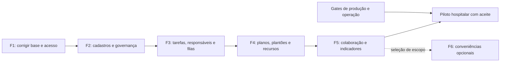

# Roadmap — planner hospitalar veterinário

**Versão:** HPL-2026-10.1 · **Data:** 11/10/2026 · **Estado:** 50 entregas em acompanhamento; reparos locais 032/036/047 validados; G4, imagens e navegador composto aprovados com reuso explícito de inputs de teste; capturas anteriores preservadas; homologação e release abertos.

**Atualização de 12/10:** os resultados completos abaixo pertencem ao snapshot de 11/10. A correção de compatibilidade HIS e a fonte corrente estão no [registro de 12/10](HOSPITAL_PLANNER_HIS_CONTRACT_FOLLOWUP_2026-10-12.md) e no [novo manifesto](HOSPITAL_PLANNER_SOURCE_MANIFEST_2026-10-12.json). G4, imagens e navegador anteriores não certificam automaticamente esse reparo de produto; CI completa deve ser conferida no GitHub. Aceites literais e gates hospitalares permanecem.

[Backlog executável](BACKLOG_HOSPITAL_PLANNER_2026-10-11.md) · [Avaliação e evidências](../avaliacoes/plane-preview-2026-10-11/relatorio.html) · [Plano de produção](PRODUCTION_ROADMAP.md) · [Decisões](../DECISION_LOG.md)

## 1. Objetivo e ponto de partida

`DECISION` — Evoluir o CVG Diagnostics Hub para um **planner dedicado ao hospital veterinário**: organizar trabalho, responsáveis, planos de atendimento, cobertura de plantão, recursos e pendências, preservando a execução diagnóstica existente. A direção documental solicitada pelo dono está registrada em D-063; os contratos refinados e sua implementação candidata estão nas fontes normativas e no [registro de implementação e validação](HOSPITAL_PLANNER_IMPLEMENTATION_2026-10-11.md).

A jornada alvo é: configurar setor, serviços/exames, usuários e acesso → receber demanda → criar e atribuir atividade → acompanhar o plano → reservar recursos → executar e registrar evidência → passar plantão com aceite → medir pendências e capacidade. Essa jornada precisa funcionar com contas operacionais normais e permissões corretas para cada função.

`FACT` — A avaliação de 11/10/2026 encontrou **137 itens**: 69 Parcial, 43 Ausente, 15 Conforme, 4 Não aplicável e 6 Não verificável. O backlog reúne os **112 itens que precisam de trabalho em 50 entregas**, mais um gate de homologação/piloto. São 40 entregas do núcleo e 10 expansões opcionais. Os outros 25 itens têm destino explícito de preservação, exclusão ou investigação.

| Base inspecionada | Referência fixada | Uso neste planejamento |
| --- | --- | --- |
| Hub atual | `a94e77f4443f700bbb073108594090d40efa4496` | Comportamento existente, lacunas e regressões a preservar. |
| Plane, branch `preview` | `bab49bb978ccb56af1d78dec6c6d54dfe8d03c1c` | Referência de organização e experiência de planejamento. |
| CVG HIS v4 | `0ebfc5b6627c8ed006075dc5285fd3514443c806` | Referência administrativa inspecionada estaticamente; adaptar estruturas sem reproduzir fragilidades de autorização. |

O pareamento Community considera **83 capacidades do Plane**, com 9 Conforme, 41 Parcial, 30 Ausente e 3 Não aplicável. Os 137 itens incluem também requisitos hospitalares, defeitos de uso e administração; não são um percentual único de paridade com o Plane.

`FACT` — A base avaliada já tinha comandos diagnósticos, versionamento de resultados, escopo clínico, linhagem de amostras, auditoria, notificações críticas e controles de concorrência. Naquela avaliação faltavam tarefas gerais, responsabilidade explícita, planos, escala real, agenda completa e colaboração. Essas capacidades estão presentes na candidata posterior; avaliação estática e testes de versões anteriores não certificam as novas entregas.

A execução posterior selecionou as 50 entregas, inclusive as expansões F5/F6 antes opcionais. A sequência e os critérios abaixo permanecem; os estados e evidências atuais estão no [acompanhamento do backlog](BACKLOG_HOSPITAL_PLANNER_2026-10-11.md#execucao). Seleção integral não dispensa conteúdo clínico, validação no alvo e aceite do piloto.

A [auditoria permanente](HOSPITAL_PLANNER_ACCEPTANCE_AUDIT_2026-10-11.json) conserva as três reavaliações literais e seus digests: 49 classificações PROVEN e 042 PARTIAL pela homologação externa.002 e 044 têm CORRECTED_TECHNICAL_PROOF, sem DONE. A interrupção 130 às 20:39, a rodada selada 1071/c8db… com 147 PASS/42 FAIL e OOM comprovado somente no cgroup descartável, e suas 5.240 provas G4 continuam históricos explícitos. A atual consolidação não altera essas capturas.

A candidata histórica anterior às adições operacionais tem **1.074 arquivos**, fingerprint SHA-256 `5bb9e94a6ede3d3d715f55b355c2c9789a2e7f286272fcd1fee37cd1e212ce82`. G4 local passou com **5.108 unitários + 141 PostgreSQL = 5.249 testes**, em **356 arquivos de teste**, 464 fontes instrumentadas, **98,41% linhas/95,93% statements/97,17% funções/92,48% branches**, com as mesmas 20 exceções existentes. Build, tipos do projeto completo, lint e segredos passaram; privacidade do bundle: **74 arquivos/zero achados**. Configuração: **238 PASS/3 skip**. A diferença de CI tem quatro regressões PASS e preserva `browser (22.x)` obrigatório, 19 specs/três projetos e Home separado; **GitHub Actions não foi executado**. Os logs/digests e limites de reuso constam no [overlay permanente](HOSPITAL_PLANNER_ACCEPTANCE_AUDIT_2026-10-11.json). Os checks finais documentais e do gate de cobertura persistida são registrados pela raiz no [registro de validação](HOSPITAL_PLANNER_VALIDATION_2026-10-11.json).

O canônico inicial de 1.073 arquivos terminou **FAIL, exit 1, 187 PASS/2 FAIL de 189**, mais **Home 3 PASS separado**, em `test-results/canonical-20261011T211723Z-3709542`. As duas falhas tablet foram GETs de observação por `APIRequestContext`, com `read ECONNRESET` antes dos asserts de domínio. Reuso/keepalive é hipótese, não causa demonstrada. A correção alterou somente o transporte de quatro GETs em dois specs para fetch único same-origin no navegador, sem retries; assertions, POSTs, CSRF, fluxos e produto ficaram iguais. Os suplementos reais na candidata histórica de 1.074 arquivos passaram: **tablet 63/63 + Home 1**, mais **três jornadas afetadas Chromium e três mobile + Home 1 de cada**, todos com exit 0. Só os **60 cenários inalterados de cada um desses dois viewports** foram reutilizados. A cobertura efetiva é **189/189 — PASS_AFTER_TEST_TRANSPORT_CORRECTION**, formada por **69 reexecutados + 120 inalterados reutilizados**; **não é uma execução única final com 189 PASS**. O FAIL inicial, o FAIL selado 147/42, as capturas/digests e os limites das provas anteriores permanecem históricos. Artefatos dos suplementos: `test-results/canonical-20261011T214110Z-3825883` e `test-results/canonical-20261011T214849Z-3855638`. Não há DONE, aceite institucional, release aplicado ou fechamento de 051; **042 continua PARTIAL**.

A referência de 042 ganhou comparação offline das **sete fontes contratuais exatas**, preservada em `sourceContractComparison` do [registro HIS](../operations/HIS_V4_INSTALLED_PROVENANCE_2026-10-11.json) e no overlay da auditoria. Os sete hashes são iguais entre o commit que corresponde ao texto da tag instalada observada e o HEAD inspecionado; artefato SHA-256 `fef4c12f6395df0b2789aa9387fb609c628299c77e1ff7897d26f923abd46e43`. Esse progresso local não prova a origem das imagens por tag mutável/labels ausentes nem realiza UAT externo: a captura original, `UNKNOWN`, `deploymentVerified:false`, **042 PARTIAL** e **051 aberto** permanecem.

## Revisão funcional posterior — 032, 036 e 047

A [nova evidência permanente](HOSPITAL_PLANNER_FUNCTIONAL_FOLLOWUP_2026-10-11.json) registra falhas reproduzidas e reparos locais: links da agenda chegam à solicitação e ao exame; execução aberta permanece visível quando cruza o período; recurso sem término real não aparece livre; filtros por plano/fase preservam os exames autorizados no cronograma. Início ausente ou inconsistente não cria horário fictício; cancelamento usa seu registro real. Reservas planejadas, estados clínicos, SLA e permissões mantêm suas autoridades.

A candidata corrente tem **1.082 arquivos**, fingerprint SHA-256 `bf1e6600023933d6e5ef313cc53596fce8332535d7ed202ab4284003ac94445c`. O produto corrigido passou no G4 completo: **5.283 testes** em 360 arquivos (5.142 unitários + 141 PostgreSQL), cobertura de linhas **98,41%**, sem novas exceções. Agenda/capacidade e cronograma passaram também nos 110 e 25 testes direcionados. O navegador reúne **195 cenários aprovados por composição: 192 + 2 + 1**, com falhas originais preservadas; não houve uma única execução completa de 195 aprovada. Tipos e lint passaram novamente na candidata atual. As imagens app/ops foram construídas, varridas, tiveram SBOM e **18 verificações de execução** aprovadas; o perfil HTTP curto passou com duas jornadas e 57 requisições. G4, imagens e perfil mediram a fonte `673bc9…`; a única alteração posterior foi o seletor/transporte de um teste E2E, com reuso explícito dos demais 1.081 arquivos e dos dois assets públicos. Relatórios e gate hospitalar mantêm seus limites.

A observação adicional do [HIS instalado](../operations/HIS_V4_INSTALLED_PROVENANCE_2026-10-11.json) às 22:59 UTC conserva a captura inicial: identidades de SPA/API mudaram e worker permaneceu igual, sem labels de revisão/origem. Não comprova o commit das imagens nem uma troca real com o Hub. **042 PARTIAL, 051 OPEN, DONE zero e release não aplicada** permanecem.

## Captura operacional anterior — 1.079 arquivos

A candidata corrigida tem **1.079 arquivos**, fingerprint SHA-256 `2afa82c5b706c9fc6469dfa4f4c2455ea43796da0c3f1aed08ce149c06f134d4`. A nova execução G4 completa passou: **5.119 unitários + 141 PostgreSQL = 5.260 testes**, em **357 arquivos**, com **464 fontes instrumentadas** e linhas: 98,41% / statements: 95,93% / funções: 97,17% / branches: 92,49%. As mesmas 20 exceções foram mantidas, sem novas exceções ou redução de mínimos. Tipos do projeto completo e lint passaram; configuração: **242 PASS/4 skips opcionais**, com entradas desse gate intactas após as duas correções de teste. A rodada anterior `6e2e33173903ea7b71a140aefd90c3a814b2bb819d4617a61dbb0db6bcedb4d6` permanece **FAIL: 5.113 PASS/2 FAIL unitários, PostgreSQL não executado**. As correções atingiram somente dois testes: inventário de segredos do exporter e espera independente do cadastro de setores, com RED determinístico e GREEN, sem alterar produto, loader ou permissões, relaxar as negativas de acesso ou aumentar timeouts.

O [registro operacional permanente](HOSPITAL_PLANNER_OPERATIONAL_EVIDENCE_2026-10-11.json) identifica build, scans/SBOM e **18 checks de execução isolada das imagens finais**, incluindo usuário normal, recusa administrativa, migrações 001–027 e worker real. `SOURCE_REVISION=unknown` identifica honestamente a árvore sem commit. O critério Trivy foi HIGH/CRITICAL corrigível e segredos detectados; ambas as imagens passaram. O bundle cliente final tem **74 arquivos/zero achados**. Banco, rede, containers e builder próprios foram removidos; os serviços hospitalares não foram modificados.

O monitor PostgreSQL tem **12 PASS/2 skips opcionais** na prova nativa: mTLS, três coletores numéricos, papel sem leitura clínica e falha fechada diante de privilégios excedentes. O [perfil HPL](../operations/HOSPITAL_PLANNER_PERFORMANCE.md) passou com **duas jornadas, 57 requisições, 11 negativas e oito invariantes**; p95 local de leitura **84,42 ms** e escrita **33,79 ms**. É regressão sintética curta; não comprova capacidade, soak ou SLO hospitalar. Os contadores `auditEvents/outbox=0` são arrays projetados, não contagens SQL ou ausência de auditoria. Instalação real, rota de alertas e carga no alvo continuam pendentes.

Navegador e performance mantêm as capturas originais com reuso explícito por entradas relevantes byte a byte iguais. Não houve nova execução de navegador após essas adições: **189 jornadas efetivas compostas**, sem alegar um único run final de 189 PASS. A mudança de `package.json` limita-se a scripts de performance, com dependências/lock intactos. O [registro atual](HOSPITAL_PLANNER_VALIDATION_2026-10-11.json) e o [histórico](HOSPITAL_PLANNER_VALIDATION_HISTORY_2026-10-11.json) conservam as capturas, falhas e limites. **042 PARTIAL, 051 OPEN, DONE zero e release não aplicada** permanecem.

## 2. Como executar e acompanhar

`DECISION` — Entregar fatias completas de persistência, API, autorização e interface. Cada fase tem um resultado de uso e critérios de saída. Protótipos e refinamento podem avançar em paralelo; liberar comportamento novo depende dos contratos e garantias que o protegem.

`ASSUMPTION` — A equipe terá capacidade para executar as fatias. Não há equipe nomeada, duração de sprint ou calendário confirmado; **F1–F6 são fases por dependência, sem promessa de datas**. Estimar e converter em calendário depois de refinar os itens e conhecer disponibilidade e conteúdo hospitalar.

O diagrama mostra a sequência principal. As dependências exatas estão em cada item do backlog: agenda e leitos podem avançar em paralelo aos plantões depois de seus pré-requisitos; passagem de plantão exige cobertura e responsabilidade. Recorrência usa modelos próprios versionados antes da biblioteca completa, evitando dependência circular.

| Fase | Entregas | Resultado verificável | Responsáveis propostos |
| --- | --- | --- | --- |
| F1 | BLD-HPL-001–010 | Registro criado é localizável; navegação, ações, escopo, histórico, fuso e acesso aos exames são coerentes. | Backend, frontend, segurança e QA. |
| F2 | BLD-HPL-011–022 | Configurar setor → serviço/exame → usuário/grupo → acesso assistencial com histórico e limites reais. | Gestão, segurança, dados e diagnóstico. |
| F3 | BLD-HPL-023–028 | Criar, atribuir, executar e encontrar tarefa geral; triar demanda e salvar visão autorizada. | Produto, equipe assistencial, backend e frontend. |
| F4 | BLD-HPL-029–036 | Organizar plano, cobertura e passagem; reservar recurso, gerir ocupação e executar rotinas. | Equipe assistencial, internação e operação hospitalar. |
| F5 | BLD-HPL-037–042 e 051 | Colaborar, seguir orientações aprovadas, medir operação e homologar o núcleo. 041–042 são condicionais. | Governança clínica, gestão, integração, QA e TI. |
| F6 | BLD-HPL-043–050 | Acrescentar conveniências selecionadas após medir o uso do núcleo. | Produto e responsáveis pelos módulos escolhidos. |

P0 é gate da primeira release que introduz ou afeta aquele comportamento. Por isso delegação/revogação em F2 e preservação de referências laboratoriais também são P0, mesmo após as correções iniciais. P1 compõe o núcleo hospitalar; P2/P3 não bloqueiam o primeiro piloto salvo dependência selecionada explicitamente.

## 3. Fases, critérios de saída e marcos

### F1 — Coerência e segurança da base

**Resultado:** o usuário cria um exame e consegue abrir o registro, navegar nos destinos corretos e ver apenas ações elegíveis. A fila e os indicadores usam o mesmo escopo autorizado.

**Entregas:** navegação; ações conforme permissão; confirmação com link e explicação de filtros; escopo de resumo/lista; paginação; preferências por pessoa/visão; fuso; conteúdo das versões; política explícita None/seleção/todos/futuros; baseline dos comandos e regressão de acesso.

**Marco M1 — base coerente:** fechar BLD-HPL-001–010 com evidência de conta operacional normal, trabalho de outro autor autorizado, gestor de IT com setores delegados e perfil de leitura. Novo registro abre pelo retorno do servidor; catálogo vazio não amplia acesso; API direta mantém negativas. A correção do filtro implícito de autor já existente não é refeita como se ainda fosse a causa de todos os casos.

**Primeira fila recomendada:** [001](BACKLOG_HOSPITAL_PLANNER_2026-10-11.md#bld-hpl-001), [002](BACKLOG_HOSPITAL_PLANNER_2026-10-11.md#bld-hpl-002), [003](BACKLOG_HOSPITAL_PLANNER_2026-10-11.md#bld-hpl-003), [004](BACKLOG_HOSPITAL_PLANNER_2026-10-11.md#bld-hpl-004), [009](BACKLOG_HOSPITAL_PLANNER_2026-10-11.md#bld-hpl-009) e [010](BACKLOG_HOSPITAL_PLANNER_2026-10-11.md#bld-hpl-010). Depois completar continuidade, preferências, fuso e histórico. Isso prioriza defeitos de uso e concessões involuntárias.

### F2 — Cadastros e governança de acesso

**Resultado:** administrar o hospital sem editar código nem corrigir setor de usuário depois de cadastrá-lo. A matriz exibida corresponde à autorização aplicada pelo servidor.

**Entregas:** ciclo de vida dos cadastros; Department e equipes; usuário com identidade/setor; grupos e matriz; delegação/revogação; prévia de acesso efetivo; migração dos nove perfis; vínculos assistenciais; serviços; definições/templates publicados; contexto de paciente/tutor.

| Objeto | Operações e vínculos necessários | Controle e aceite principal | Backlog |
| --- | --- | --- | --- |
| Setor | Criar, consultar, editar, inativar; código, responsável, equipe e tipo. | Identidade estável, referências históricas e integração dinâmica em menus/filas. | 011–013 |
| Serviço | Criar, publicar/ativar, consultar, editar e inativar; setor, equipe e recursos. | Novo vínculo exige setor válido; histórico permanece; acesso futuro é política explícita. | 009, 020 |
| Exame do catálogo | Definir modalidade, template/referências, publicar revisão e inativar. | Identidade diferente do exame do paciente; laudo conserva definição/faixa utilizada. | 008, 021 |
| Usuário | Criar no setor autorizado, editar identidade, vincular grupo, inativar e gerir sessões. | Elegibilidade clínica, limite de delegação e acesso inicial explícito. | 014, 016, 018 |
| Grupo de acesso | Criar, consultar, editar matriz, revisar e inativar. | Criar/alterar/desativar são independentes quando o editor permite escolha independente; API prova isso. | 015–018 |
| Escopo assistencial | Conceder/retirar paciente e vínculos; explicar acesso efetivo. | Grupo/atribuição não torna pacientes globais; revogação vale na próxima operação. | 017, 019, 022 |

As permissões de quem administra cada objeto são definidas por comando e limite delegável. Preservar ADMIN técnico, MANAGER restrito e SUPERADMIN, sem copiar o privilégio administrativo clínico ou o `users.manage` amplo do HIS. A [matriz 55×9 da avaliação](../avaliacoes/plane-preview-2026-10-11/matriz-permissoes-atuais.csv) conserva o baseline histórico; a candidata contém 148 permissões para nove perfis, conforme [PERMISSIONS](../spec/PERMISSIONS.md). Paciente, setor, serviço, estado, sessão e autoria ainda restringem a ação.

**Marco M2 — configuração governada:** fechar BLD-HPL-011–022; cadastrar um setor novo e completar sua cadeia de configuração sem hardcode. Prévia de acesso corresponde ao resultado; comparar migração antes/depois sem ampliação involuntária; retirada funciona com sessão aberta; último administrador permanece protegido. Template/referência utilizados são preservados para novos resultados e limitações históricas ficam explícitas.

### F3 — Núcleo utilizável do planner

**Resultado:** criar uma rotina operacional ou tarefa assistencial real, designar responsável e concluir com evidência, sem inventar serviço diagnóstico para isso.

**Entregas:** HospitalTask e seus tipos/estados; autor separado de responsável/equipe; prioridade e datas; subtarefas/dependências; visões privadas/compartilhadas; intake; busca autorizada. Busca ganha novos tipos de objeto quando as fases seguintes os entregarem.

**Marco M3 — trabalho planejável:** fechar BLD-HPL-023–028. Um profissional autorizado cria, encontra, assume ou atribui e executa a tarefa. “Minhas atribuídas” é filtro explícito; visão compartilhada não concede acesso a pacientes. Aceitar demanda não duplica tarefa. Dependências cíclicas são negadas e exames mantêm seus comandos autoritativos.

Protótipo e refinamento podem usar os nove perfis atuais após F1. A release persistente precisa dos contratos de setor, elegibilidade e escopo necessários de F2; não se expõe um editor de grupos sem delegação/revogação já implementadas.

### F4 — Atendimento, cobertura e capacidade

**Resultado:** acompanhar um plano entre setores, conhecer equipe vigente, entregar pendências ao próximo plantão e reservar recursos reais.

**Entregas:** plano do atendimento; turnos/cobertura/substituições; passagem com aceite; agenda de profissionais/salas/equipamentos; inventário/censo de leitos; rotinas recorrentes/checklists; procedimentos não diagnósticos aprovados; capacidade e SLA distintos.

**Marco M4 — continuidade assistencial planejada:** fechar BLD-HPL-029–036. Handover conserva pendências e identifica responsável antes/depois do aceite. Duas reservas ou ocupações incompatíveis são recusadas em concorrência real. Retry não duplica ocorrência de rotina. Plano concluído/arquivado não encerra exames automaticamente; alta não oculta exames ativos.

Reutilizar a reserva por intervalo/recurso e o contexto de internação existentes. Não criar autoridade paralela de agenda, ocupação ou estado clínico. D7/D-032 conserva SLA em horas corridas desde a solicitação; disponibilidade de recurso não altera essa política silenciosamente.

### F5 — Colaboração, gestão e homologação

**Resultado:** a equipe conversa no contexto autorizado, utiliza orientações aprovadas e mede planejamento/execução com números explicáveis.

**Núcleo:** comentários/anexos (037), notificações e preferências (038), biblioteca com aprovação/versionamento (039) e indicadores (040). **Condicionais:** relatórios/exportação (041) e integrações de sistemas efetivamente adotados (042).

**Marco M5 — núcleo homologado:** fechar 037–040 e [051](BACKLOG_HOSPITAL_PLANNER_2026-10-11.md#bld-hpl-051), com as fases anteriores. Marcar lido não confirma crítico nem aceita passagem; comentário/menção não concede paciente; orientação aprovada exige nova revisão para mudar. Indicadores informam janela, escopo, denominador e origem e não contam exame duplicado por estar em vários planos.

Integração só vira condição de piloto se uma jornada selecionada depender de HIS/LIS/PACS. Nesse caso, validar contrato, revogação, idempotência e recuperação com o sistema real/sandbox antes do aceite. Relatórios e integrações não contratados permanecem opcionais.

### F6 — Conveniências e expansões selecionadas

**Resultado:** melhorar o uso a partir da medição do piloto, sem deslocar os marcos anteriores.

**Opções:** configuração institucional/convites/módulos/arquivo; perfil/favoritos/recentes/notas; drafts/descrições/labels/estimativas/links/assinaturas; lote; Gantt/tabela editável; editor rico/coedição; arquivo pessoal de notificações; assistência de IA revisável.

**Marco M6 — melhoria comprovada:** selecionar itens 043–050, nomear responsáveis, medir benefício e registrar aceite por item. Notas, reações e IA são P3 dentro dos agrupamentos e podem ser adiadas. Recursos comerciais não inspecionados do Plane permanecem investigação; não são obrigação de compra ou cópia.

## 4. Garantias, migração e critérios de release

`DECISION` — Os [15 registros INV](BACKLOG_HOSPITAL_PLANNER_2026-10-11.md#4-garantias-existentes-a-preservar) são gates de regressão das entregas afetadas. Preservar comandos/FSM diagnósticos, versões, autoria de resultado, amostra/recoleta, confirmação crítica, escopo, auditoria, retenção, último administrador e separação catálogo/pedido.

Grupo concede comandos dentro das fronteiras de perfil/elegibilidade e escopo; não concede automaticamente paciente. Layout, arrastar card, checklist e integração encaminham ao comando correto. SUPERADMIN não elimina controle de sessão, concorrência ou autoria de rascunho.

| Risco | Regra de execução | Evidência exigida |
| --- | --- | --- |
| Lista vazia ou catálogo vazio amplia acesso | Migrar grants materializados; futuro exige política explícita; mostrar afetados. | Casos de nenhum/seleção/todos, primeiro serviço, importação, reativação e transferência. |
| Flags da interface compartilham uma permissão ampla | Só oferecer ações independentes com autorização independente na API. | Grupo create-only cria e recebe negativa para update/deactivate. |
| Grupo novo altera a fronteira clínica | Preservar perfil/elegibilidade, scopes e limites delegáveis; comparar antes/depois. | Nove perfis, grupos iniciais, paciente/setor/serviço/autoria/estado e última conta administrativa. |
| Revogação não alcança sessão/cache/stream | Revalidar política corrente em leitura/comando e antes de emitir conteúdo. | Sessão/SSE abertos e concessões alternativas explicadas. |
| Catálogo atualizado muda interpretação de laudo | Versionar publicação e conservar definição/faixa utilizada; não fabricar histórico ausente. | Laudo antigo após edição/importação e limites de migração declarados. |
| Estado duplicado entre tarefa/plano/exame | Referenciar objetos e derivar projeções da autoridade correta. | Encerrar plano/checklist não conclui exame nem confirma crítico. |
| Agenda/ocupação disputa o mesmo recurso | Evoluir comandos existentes, validar conflito na persistência autoritativa. | Reservas, leitos e transferências concorrentes em PostgreSQL. |
| Crescimento do planner pressiona persistência | Rever volume e índices no programa PROD-111/TEC-01 e D-061. | Carga no volume alvo; decisão de armazenamento, sem cutover imposto apenas pela referência. |
| Auditoria torna a administração burocrática | Respeitar D-024: contexto/ator/versão automáticos; motivo e senha segundo risco/regra clínica. | Jornada medida, sem campos técnicos desnecessários, com trilha completa. |

Cada migração precisa descrever leitura de dados antigos, efeito nos grants/vínculos, caminho de atualização, compatibilidade e recuperação. Migração irreversível usa backup/restore ensaiado; não prometer rollback de código quando o schema ou a autoridade mudou.

## 5. Produção continua com gates próprios

Este roadmap define evolução de produto. [PRODUCTION_ROADMAP.md](PRODUCTION_ROADMAP.md), [PRODUCTION_BACKLOG.md](PRODUCTION_BACKLOG.md) e [PRODUCTION_READINESS.md](../operations/PRODUCTION_READINESS.md) continuam definindo release, operação e go-live. O gate 051 compartilha esses aceites e o piloto institucional PROD-703, sem criar um segundo programa de implantação.

`FACT` — D1–D12 têm decisões registradas na [ata de 08/10/2026](PACOTE_DECISOES_2026-10-08.md#ata-de-08102026), D-032. Isso não elimina entradas e evidências pendentes: conteúdo clínico/valores críticos, catálogo do hospital, prazos legais, infraestrutura/destino externo, contatos/canais, ensaios no alvo e nomes/datas do piloto. Consultar os itens específicos e seus registros; resumos antigos não reabrem decisões já tomadas.

**Saída para o piloto hospitalar completo:** 40 entregas do núcleo aceitas; opcionais selecionadas aceitas; 15 invariantes revalidadas; zero P0 aberto no escopo; UAT com usuários reais; permissão permitida/negada validada; carga e recuperação no alvo; observabilidade e responsáveis operacionais definidos; conteúdo clínico homologado. Commit, imagem, schema e evidências identificam o candidato aceito.

Releases técnicas intermediárias podem corrigir a base e abrir módulos restritos conforme seus gates. Elas não certificam conclusão de todo o planner nem substituem aprovação clínica/operacional.

## 6. Decisões a refinar antes das entregas dependentes

As perguntas abaixo não impedem salvar o plano nem iniciar F1. A entrega dependente só fecha quando sua decisão estiver registrada.

| Questão | Decisão/entrada necessária | Responsável proposto | Destrava |
| --- | --- | --- | --- |
| Tipos e contexto das tarefas | Quais rotinas são operacionais, assistenciais e procedimentos; quais campos/comandos cada tipo exige. | Produto + equipe clínica. | 023–025, 027, 035. |
| Reclassificação de prioridade | Unidade solicitação/item, ator elegível, motivo conforme risco e efeito no dueAt para pendências/em execução; conservar criticidade e relógio desde a solicitação. | Coordenação clínica + produto. | 024. |
| Grupos e delegação | Catálogo por ação, elegibilidade separada, composição com perfil e concessões existentes; limite de cada ator. | Segurança + gestão. | 015–019. |
| Desativação de cadastros | Efeito sobre pendências, novos vínculos e concessões alternativas de grupo/setor/equipe. | Gestão + segurança. | 011–020. |
| Histórico de templates | Instante de fixação da definição/referência e tratamento honesto do legado sem snapshot. | Diagnóstico + dados. | 021. |
| Handover | Quem responde até aceite, recusa/substituição e escalada por falta de recebedor. | Coordenação assistencial. | 030–031, 038. |
| Agenda e leitos | Inventário, compatibilidade, disponibilidade e autoridade clínica da transferência/alta. | Operação + internação. | 032–033, 036. |
| Rotinas e orientações | Modelos aprovados, confirmação por etapa e autoridade para publicar/revisar. | Governança clínica. | 034–035, 039. |
| Indicadores e piloto | Definições de tempo/capacidade/pendência, participantes, cenários e datas após capacidade confirmada. | Gestão + QA + TI. | 040, 051. |
| Integrações e opcionais | Sistemas realmente usados e recursos que a jornada do piloto exige. | Produto + TI. | 041–050 conforme seleção. |

## 7. Fontes de verdade e manutenção

O [backlog HPL](BACKLOG_HOSPITAL_PLANNER_2026-10-11.md) é dono dos IDs BLD-HPL-* e da rastreabilidade dos 137 itens. O [backlog IMP](IMPROVEMENT_BACKLOG_2026-10.md) conserva entregas anteriores e o [backlog PROD](PRODUCTION_BACKLOG.md) conserva os gates de produção. A seção 7 do backlog HPL resolve interseções como UX-01/02/03/04, COR-10/11, troca de senha já entregue, SLA aprovado e agenda existente; reutilizar implementação/evidência, sem duplicar tarefas.

Antes do BUILD, refletir contratos aprovados em [PRD](../prd/PRD.md), [modelo de domínio](../spec/DOMAIN_MODEL.md), [permissões](../spec/PERMISSIONS.md), [máquinas de estado](../spec/STATE_MACHINES.md), [API](../api/API_SPEC.md) e [rastreabilidade](../TRACEABILITY_MATRIX.md). Registrar decisões duráveis no decision log/ADR. Esta proposta não altera silenciosamente contratos existentes.

Revisar o backlog quando houver evidência nova: atualizar estado por entrega, registrar candidato e aceite, conferir dependências, manter destino dos itens excluídos/investigativos e reabrir regressões encontradas. Marco só é concluído com suas evidências; documento criado não equivale a funcionalidade entregue.
