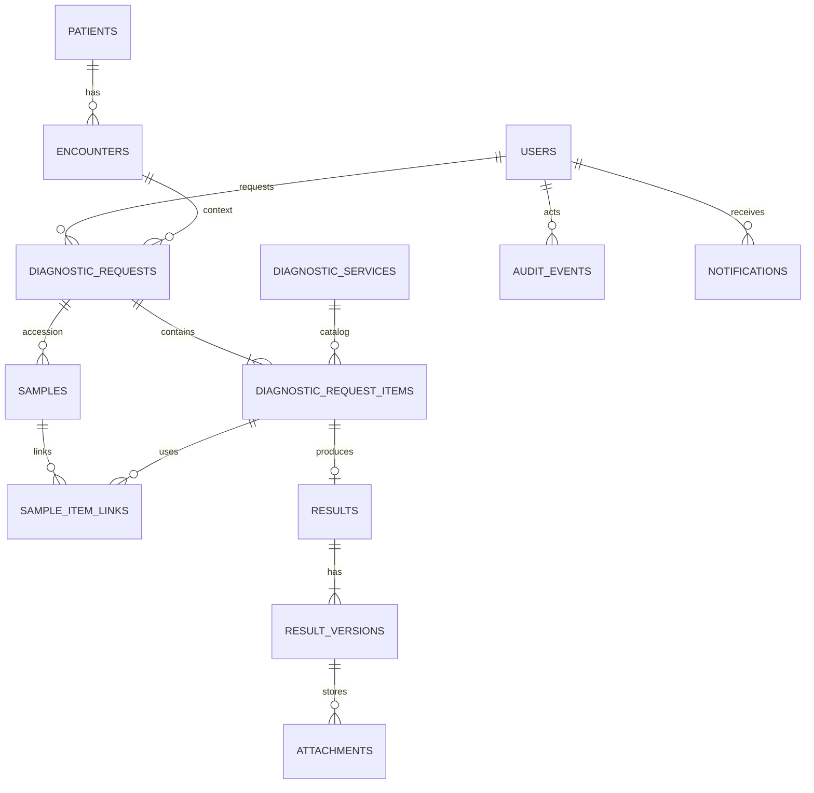

# Data Model

**Knowledge status:** `DECISION` técnica + `TRANSITIONAL IMPLEMENTATION` (2026-08-23). As tabelas abaixo são o alvo relacional normativo; o runtime atual ainda persiste o agregado `StoreState-v1` em JSONB e projeta auditoria/outbox/apoio. Retenção e integrações são `OPEN QUESTION`.

## 0. Current persistence boundary

`PostgresStore` usa a tabela `runtime_state` como fonte autoritativa temporária para o estado clínico inteiro. A migration `006_transitional_snapshot_boundary.sql` registra em `runtime_storage_boundaries`:

| Campo | Valor atual |
| --- | --- |
| boundary | `runtime-jsonb-snapshot-v1` |
| authoritative source | `cvg_runtime_entities` (uma linha por entidade) + cabeçalho e versão em `cvg_runtime_state` (migration 015, D-030) |
| contract | `StoreState-entities-v1` (mesmo `StoreState`, persistido por entidade) |
| status | `TRANSITIONAL` |
| consistency | `CONTINUOUS` reconciliation |
| relational projections | audit events, outbox messages, rate-limit buckets |

O contrato impede que essa transição seja confundida com um schema relacional clínico concluído. O harness PostgreSQL prova migration/readiness, reload, transações, projeção/read/reconciliation de request/item/sample/link com membership completo, replay idempotente, rollback adapter/snapshot, uma linhagem de resultado por item, auditoria, outbox e concorrência; a leitura do agregado também possui `EXPLAIN` estrutural local com fan-out de distração e caminhos indexados. Ainda faltam backfill/cutover autoritativos, workload aprovado/representativo, revisão de todos os FKs/checks/índices de produção e prova browser sobre a seam relacional.

## 1. Conventions

- PostgreSQL; PK técnica UUIDv7 (ou equivalente monotônico aprovado), nunca exposta como única chave humana.
- `created_at`, `updated_at` e eventos são `timestamptz` UTC; timestamps operacionais são nullable quando não aplicáveis.
- Tabelas clínicas não são apagadas fisicamente por usuário comum.
- `version` protege concorrência otimista.
- `status`/`enum` armazenam códigos em inglês; labels são UI.
- Campos JSON só guardam conteúdo de workflow/result schema versionado, não substituem constraints centrais.

## 2. Identity and organization tables

| Table | Fields/meaning | Constraints/indexes |
| --- | --- | --- |
| `users` | id, display_name, email/login, active, timezone, created_at, version | unique normalized login; no secret in profile |
| `roles` | id, code, name, active | unique code |
| `user_roles` | user_id, role_id, department_id?, valid_from/to | unique active assignment; FK |
| `departments` | id, code, name, kind, active | unique code |
| `sessions` | id, user_id, token_hash, created/expires/revoked_at, last_seen | unique token hash; never store raw token |
| `auth_identities` | user_id, provider, subject | unique provider+subject |

## 3. Registry tables

| Table | Fields/meaning | Constraints/indexes |
| --- | --- | --- |
| `patients` | id, display_name, species, breed, sex, birth_date/approx, active, created/updated | indexes normalized display_name/species |
| `owners` | id, display_name, contact fields only as approved, privacy flags | access/retrieval scope; no tutor channel in MVP |
| `patient_owners` | patient_id, owner_id, relation, valid_from/to | FK; current relation constraint |
| `external_references` | entity_type/id, source_system, external_id | unique source_system+entity_type+external_id |
| `encounters` | id, patient_id, source_system, external_id?, type, status, opened/closed_at | patient FK; index active patient |
| `admissions` | id, encounter_id, department/ward/bed snapshot, admitted/discharged_at | history rows for transfers; no overwrite without event |

## 4. Catalog and policy tables

| Table | Fields/meaning | Constraints/indexes |
| --- | --- | --- |
| `diagnostic_services` | id, code, name, category, department_id, workflow_type, capability flags, active | unique code; index active/department/workflow |
| `service_instructions` | service_id, version, text, active_from/to | immutable versions |
| `sla_policies` | id, service_id, priority, calendar, start_event, duration, version, active | unique service+priority+version; policy snapshot on item |
| `critical_result_policies` | id, service_id, definition_ref/config, recipient rule, ack deadline, escalation, version | no hardcoded clinical thresholds; approval metadata |
| `reason_codes` | id, type (`RECOLLECTION`, `CANCEL`, `REJECT`, `AMEND`), code, label, active | unique type+code |

## 5. Diagnostics tables

| Table | Fields/meaning | Constraints/indexes |
| --- | --- | --- |
| `request_code_sequences` | local_date, next_value | PK date; row lock per allocation |
| `diagnostic_requests` | id, request_code, patient_id, encounter_id, admission_id?, requester_id, requesting_department_id, priority, aggregate projection, created/updated, version | unique request_code; FK; indexes patient/encounter/created/status projection |
| `diagnostic_request_items` | id, request_id, service_id, department_id, workflow snapshot, priority, status, reason fields, operational timestamps, due_at/sla fields, version | unique request+service only if policy says; indexes status/department/priority/due/patient via request |

Do not enforce unique request+service blindly: duplicate override can be clinically necessary. Use an active duplicate lookup and explicit audit instead.

## 6. Samples and imaging tables

| Table | Fields/meaning | Constraints/indexes |
| --- | --- | --- |
| `samples` | id, request_id, accession_code, sample_type, status, replaces_sample_id?, collected/received fields, rejection code/note, version | unique accession; FK chain cannot cross request |
| `sample_item_links` | sample_id, item_id, link_status, linked_at/by, rejection details, version | unique sample+item; check same request; historical links are versioned and never silently removed |
| `procedures` | id, item_id, workflow_type, status, performed_at/by, metadata JSON schema version | unique active procedure per item |
| `procedure_schedules` | id, procedure_id, starts/ends, resource, status, reason, actor, version | no overlapping active schedule per resource if policy requires |

Durante a seam transitória 007–009, `samples.item_ids` é uma coluna de projeção
usada para preservar a membership declarada pelo snapshot e tornar a leitura
relacional verificável. Ela não muda a autoridade do JSONB nem substitui a tabela
normalizada `sample_item_links` no modelo relacional alvo.

## 7. Results and files

| Table | Fields/meaning | Constraints/indexes |
| --- | --- | --- |
| `results` | id, item_id, current_version_id, lifecycle_status, needs_re_review, needs_replacement, created/updated, version | unique item_id; FK current version deferred/transactional |
| `result_versions` | id, result_id, sequence, status (`DRAFT`, `RELEASED`, `SUPERSEDED`, `VOIDED`), content JSON, narrative, conclusion, author_id, released_at/by, amendment_reason, supersedes_id, policy/schema version, checksum, created_at | unique result+sequence; immutable after commit |
| `result_components` | version_id, code, value, unit, reference range, abnormal flag, order | unique version+code/order; optional panel detail |
| `attachments` | id, result_version_id, storage_key, safe_name, detected_mime, size, checksum, scan_status, upload status, created_by/at | unique storage_key/checksum as policy; deny public ACL |

## 8. Communication/audit tables

| Table | Fields/meaning | Constraints/indexes |
| --- | --- | --- |
| `notifications` | id, category, priority, recipient_user/team, entity_type/id, deep_link, dedupe_key, state, version, created_at, expires_at | dedupe unique per event/recipient/version; acknowledgement uses optimistic version, reason and explicit confirmation |
| `notification_deliveries` | notification_id, channel (`IN_APP` MVP), status, attempts, last_error, sent/seen_at | unique notification+channel |
| `acknowledgements` | notification_id, result_version_id?, actor_id, acknowledged_at, method | one current acknowledgement per recipient/version; history as audit |
| `audit_events` | id, event_type, actor_id/system, entity_type/id, previous_state, new_state, correlation_id, metadata allowlist, occurred_at | append-only permissions; indexes entity/time/correlation |
| `outbox_messages` | id, event_type, aggregate_type/id, payload, status, attempts, available_at, processed_at, correlation_id | unique event id; worker index status/available |
| `idempotency_keys` | actor_id, scope/endpoint, key, payload_hash, response reference, expires_at | unique actor+scope+key |

## 9. Core constraints

```text
FK: request.patient_id → patients.id
FK: request.encounter_id → encounters.id and encounter.patient_id = request.patient_id (domain/trigger validation)
FK: item.request_id → diagnostic_requests.id
FK: result.item_id → diagnostic_request_items.id (one logical result per item in MVP)
UNIQUE: diagnostic_requests.request_code
UNIQUE: samples.accession_code
CHECK: samples.accession_code matches the canonical uppercase accession namespace
CHECK: samples.rejection_reason_id is not null for REJECTED and REPLACED samples
CHECK: sample_item_links.link_status is ACTIVE, REJECTED, or REPLACED
UNIQUE: result_versions(result_id, sequence)
CHECK: released_at is not null only for RELEASED/SUPERSEDED version
CHECK: amendment_reason is not null when supersedes_id is not null
CHECK: due_at >= sla_started_at when both exist
```

Cross-row invariants (same request, sample link, current version, state transitions) are enforced in domain transaction plus database FKs/unique/checks where PostgreSQL can express them.

## 10. Core column contract (types/nullability)

`NN` = `NOT NULL`; `NULL` = optional/applicability-dependent. Every table also has `created_at timestamptz NN`; mutable tables have `updated_at timestamptz NN` and `version integer NN`.

| Table | Column | PostgreSQL type | Nullability/key |
| --- | --- | --- | --- |
| `diagnostic_requests` | `id` | `uuid` | PK, NN |
|  | `request_code` | `varchar(20)` | UNIQUE, NN |
|  | `patient_id`, `encounter_id`, `requester_id`, `requesting_department_id` | `uuid` | FK, NN |
|  | `admission_id` | `uuid` | FK, NULL |
|  | `priority` | `varchar/enum` | NN, CHECK |
|  | `aggregate_status` | `varchar/enum` | NN, derived projection |
| `diagnostic_request_items` | `id`, `request_id`, `service_id`, `department_id` | `uuid` | PK/FK, NN |
|  | `status`, `priority`, `workflow_type` | `varchar/enum` | NN, CHECK |
|  | operational timestamps, `sla_started_at`, `due_at`, reason IDs | `timestamptz/uuid` | NULL when not applicable |
| `samples` | `id`, `request_id` | `uuid` | PK/FK, NN |
|  | `accession_code`, `sample_type`, `status` | `varchar/enum` | UNIQUE/NN |
|  | `replaces_sample_id`, rejection code/note | `uuid/varchar/text` | FK/NULL; reason required on rejection |
| `results` | `id`, `item_id` | `uuid` | PK/UNIQUE FK, NN |
|  | `current_version_id` | `uuid` | FK, NN after first release; transactional deferral allowed |
|  | `lifecycle_status`, `needs_re_review` | `varchar/boolean` | NN |
| `result_versions` | `id`, `result_id`, `sequence`, `status` | `uuid/uuid/int/varchar` | PK/FK/UNIQUE/NN |
|  | `content`, `narrative`, `conclusion` | `jsonb/text/text` | content schema NN; optional fields NULL |
|  | author/release/amend/supersedes fields | `uuid/timestamptz/text` | release/ amendment conditional NULL |
| `attachments` | `id`, `result_version_id` | `uuid` | PK/FK, NN |
|  | `storage_key`, `detected_mime`, `checksum`, `scan_status` | `varchar/bytea/varchar/enum` | NN |
|  | `size_bytes`, `uploaded_by`, `uploaded_at` | `bigint/uuid/timestamptz` | NN after finalize; upload draft may be NULL |
| `audit_events` | `id`, event/entity type/id, `occurred_at` | `uuid/varchar/uuid/timestamptz` | PK/NN |
|  | `actor_id`, previous/new state, correlation, metadata | `uuid/varchar/varchar/varchar/jsonb` | actor/system and metadata policy; sensitive payload NULL/allowlisted |

Use `CHECK`, domain validation and conditional indexes for fields whose nullability depends on state. Do not make every future workflow column mandatory in the core.

## 10. Index plan

- exact `request_code`, external ID, accession;
- `diagnostic_request_items(department_id,status,priority,due_at,created_at)`;
- patient/encounter joins and active requests;
- normalized patient/tutor/service/professional search; trigram only if measured;
- audit entity/time and correlation;
- outbox status/available;
- notification recipient/state/created.

Index review must use `EXPLAIN` with representative skew/empty/large cases before release; do not index every column.

## 11. ERD (MVP core)



## 12. Migrations and retention

Schema changes use migrations and expand/contract for destructive changes. Retention durations are `OPEN QUESTION` OQ-013; until approved, production must not configure deletion jobs. Archive/cancel/void preserve audit history and are preferred to silent delete.

## Evolução HPL: cadastro persistente de setores

`Department` entra em `StoreState.departments` e nas linhas `cvg_runtime_entities`, com chave `id` e índice único de `code` por coleção. A migration 019 amplia o contrato de coleções e cabeçalho, materializa os setores referenciados, mantém todos os dados clínicos e registra a migração em auditoria. Nova aplicação requer o novo schema; atualização é coordenada, com app/worker parados, backup e restauração como recuperação. O código anterior não deve operar contra o schema novo. Nunca editar migrations anteriores já entregues.

O cadastro de setor usa controle otimista `version`, idempotência por ator/operação e serialização da transação existente. Desativação é lógica; nenhuma FK histórica é apagada. Responsável/equipe são metadados de organização, sem alterar grants.

## Evolução HPL: definição diagnóstica congelada

BLD-HPL-021 adiciona `StoreState.examDefinitions`: revisões imutáveis com `id`, `serviceId`, `serviceVersion`, `status`, `recordedAt`, `recordedBy`, `provenance` (`CATALOG_WRITE` ou `CATALOG_OBSERVATION`) e `definition`. A definição contém código/nome, categoria/setor/fluxo, exigência/tipo de amostra, agenda, anexos, schema/template integral e SLA configurado. A chave de revisão combina serviço e versão; regravar a mesma identidade com conteúdo diferente é recusado. `DiagnosticItem.definitionSnapshot` e `ResultVersion.definitionSnapshot` são opcionais apenas para compatibilidade com legado: `schemaVersion: 1`, `capturedAt`, `provenance`, `definitionId`, `serviceId`, `serviceVersion`, `definition` e `patientContext` (espécie, sexo e nascimento quando conhecido). Valores inexistentes não são inventados. As capturas não podem ser substituídas por uma edição do catálogo. A migração inicializa a coleção de histórico, preservando todos os payloads clínicos existentes e sem fabricar snapshots anteriores.

## Extensão HPL: grupos e escopos assistenciais

O agregado inclui `accessGroups` e `patientGrants`, persistidos pelo mesmo codec/entidades e transação do restante do estado. `AccessGroup` tem ID, código único, descrição, estado, revisão, permissões e timestamps; `systemRole` identifica os nove grupos iniciais. `User.accessGroupId` é a única autoridade do vínculo atual. Não há segunda coleção de associações que possa divergir. `permissions` em Actor/SessionUser é projeção efêmera do resolvedor e não substitui grupos ou o perfil persistido.

A migração 020 materializa um grupo inicial por perfil, mantendo o teto anterior e vinculando usuários sem ampliar seus grants. Cada `patientId` legado gera `PatientGrant` com fonte `LEGACY`, sem inventar uma autoria histórica. Fonte `ADMIN` registra o ator e a última concessão/retirada; `PATIENT_CREATION` registra o vínculo assistencial do criador. Grants retêm revisões e estado inativo, enquanto os eventos de auditoria conservam o histórico. `patientIds` continua materializado para compatibilidade com consultas limitadas e autorização; mutações explícitas atualizam grant e lista atomicamente.

A prévia efetiva tem `userVersion` e `groupVersion`. O comando de vínculo exige `expectedVersion` do usuário e aceita `expectedGroupVersion` da prévia; o editor envia ambas para evitar salvar uma decisão diferente após edição concorrente. Versão de grupo, identidade, vínculo e concessão nunca vem de uma permissão declarada pelo cliente.

### Serviços hospitalares (BLD-HPL-020)

Coleção `hospitalServices` contém `HospitalService`: `id`, `code`, `name`, `description?`, `kind` (`CARE|PROCEDURE|OPERATIONAL`), `departmentCode`, `teamUserIds`, `resourceIds`, `active`, `version`, `createdAt`, `updatedAt`. Códigos não colidem com `services` diagnósticos. As referências de equipe não são grants; os recursos são resolvidos na autoridade de inventário quando disponível e referências não resolvidas são rejeitadas.

`HospitalServiceCatalogEntry` é uma união de projeções com `source` (`HOSPITAL_SERVICE|DIAGNOSTIC_SERVICE`); apenas o primeiro tipo persiste nesta coleção. `HospitalServiceSnapshot` congela `source`, `serviceId`, `serviceVersion`, `code`, `name`, `kind` (inclui `DIAGNOSTIC`), `departmentCode`, `teamUserIds`, `resourceIds` e `capturedAt` na criação de uma atividade. A captura não cria equipe, recurso ou acesso ao paciente e não é substituída na leitura pelo catálogo atual.

### Configurações de visão (BLD-HPL-026)

`savedPlannerViews` guarda `id`, `name`, `ownerId`, `sharedDepartmentCode?`, `filters`, `display`, `active`, `version`, `createdAt` e `updatedAt`. `filters` admite setor, responsável, tipo, prioridade, fase, período e plano; `display` admite layout, ordem, direção, agrupamento e colunas selecionadas. `expectedVersion` pertence ao comando e não é persistido. A migração 023 cria a coleção vazia; nenhuma preferência de navegador sem proprietário conhecido é promovida a visão compartilhada.

## Persistência inicial do planner (BLD-HPL-023–028)

As coleções `hospitalTaskTypes`, `hospitalTasks`, `hospitalTaskDependencies` e `hospitalIntakes` têm identidades próprias e versionamento. Os tipos iniciais ROUTINE/CARE não criam tarefas sintéticas em produção. HospitalTask conserva `typeSnapshot` e, quando aplicável, `serviceSnapshot`; reedição do catálogo não reinterpreta essas atividades. Fase/status têm autoridade somente nos comandos de tarefa.

HospitalTask registra authorId, responsibleUserId opcional, executorTeamUserIds e participantUserIds separadamente, além de prioridade, datas planejadas e executor/horário reais. parentTaskId/sortOrder compõem tarefas sem copiar exames. HospitalTaskDependency registra origem, tipo/ID da autoridade de destino, comando bloqueado, active e versão. HospitalIntake conserva origem manual/solicitação real, estado de triagem, avaliador, motivo e destino; os comandos acrescentam auditoria e evento durável na mesma transação.

Listas e busca contam apenas objetos autorizados. Ordenação de tarefas e busca por atualização, prioridade ou início planejado é global antes da página; cursor inclui a ordem/direção e não pode ser reutilizado em ordenação incompatível. Filtro de período de tarefa usa início planejado e, quando não há planejamento, criação; responsável é uma restrição explícita, separada de todo o trabalho ativo autorizado.

## Inventário e evidências de execução (BLD-HPL-032–036)

hospitalResources guarda HospitalResource com id/code/name/kind/departmentCode, userId para PROFESSIONAL, ward/bedLabel/allowedSpecies para BED, availability AVAILABLE/BLOCKED/MAINTENANCE, availabilityWindows, active/version e timestamps. Referências de serviço resolvem IDs ativos do mesmo setor. Cadastro de inventário não altera grupos, escopo de paciente ou concessões de execução.

schedules é a autoridade compartilhada HospitalSchedule: procedureId ou hospitalTaskId, startsAt/endsAt UTC, texto de exibição legado, resourceIds/resourceSnapshots opcionais apenas no legado, status e revisão. Novas reservas validam exatamente um vínculo existente e conflitos de todos os IDs no estado persistente serializado. Cancelamento/remarcação acrescenta trilha e conserva linhas históricas. Admission continua a única ocupação e ganha bedResourceId opcional para legado; transferência/mudança vincula destino e verifica exclusividade na mesma transação. A migração não aproxima rótulos ou cria inventário/ocupação sintéticos.

HospitalTask.careExecution contém HospitalCareExecution: ID, performedAt/performedBy gerados pelo servidor, modalidade, templateId/templateVersion e aprovação congelada, referência clínica declarada, referências de sistema/política e resourceSnapshots reais quando reservados. recordEvidence=EXECUTOR_REFERENCE distingue essa declaração de comprovante de integração externa. Conclusão da Task, reservas e auditoria são atômicas e idempotentes; snapshots e laudos diagnósticos permanecem independentes.

### Autoridades persistentes de planejamento

`hospitalPlans`, `hospitalShifts`, `hospitalHandoffs`, `hospitalChecklistTemplates` e `hospitalRecurrences` são coleções obrigatórias do estado e da persistência, inicialmente vazias em instalação e migração. Nenhum dado sintético materializa aprovação, plantão, passagem ou ocorrência em produção. `HospitalPlan.links` conserva referências às autoridades originais, não cópias de tarefas/exames. Tarefas e `DiagnosticPlanning` usam `shiftId` opcional; a associação nunca reinicia seus relógios.

O snapshot de checklist na tarefa contém identidade/versão do modelo, aprovação e etapas congeladas; suas execuções possuem autoria e invalidações preservadas. `recurrenceId` e `occurrenceAt` identificam uma ocorrência junto à tarefa; cursor, tarefa e audit/outbox são gravados atomicamente. `lastError` contém código técnico, sem texto do paciente. Uma falha repetida com o mesmo código não acrescenta auditoria idêntica a cada rodada. Reservas de tarefa usam a autoridade única `schedules`, com `hospitalTaskId` e ausência de `procedureId`; conclusão/cancelamento fecha reservas vigentes atomicamente, conservando versões e histórico.
### Biblioteca operacional — BLD-HPL-039/048

`hospitalDocuments` persiste `HospitalDocument` com código único, setor imutável, responsável, bloqueio, arquivo, versão do agregado e revisões embutidas. `currentPublishedRevisionId` mantém a última publicação inclusive após retirada; `draftRevisionId` identifica o único rascunho atual. A revisão contém número monotônico, título, JSON estruturado, versão própria, autoria e instantes do servidor, estado `DRAFT|APPROVED|RETIRED` e, após aprovação, referência institucional e aprovador. A publicação, retirada e atualização dos ponteiros pertencem à mesma transação.

`HospitalDocumentSnapshot` em tarefa/plano contém identidade, setor, número e ID da revisão, conteúdo, aprovação, referência institucional e instante da captura. Conteúdo publicado não recebe atualização em lugar: novas revisões não alteram essas capturas. Duplicação conserva `sourceDocumentId/sourceRevisionId` e cria novo documento e rascunho. Não há backfill que invente documentos ou aprovações.

Favoritos usam a preferência privada por usuário e entidade `HOSPITAL_DOCUMENT` em `workActivityPreferences`; a resposta de documentos inclui apenas o favorito do ator atual. Preferência não concede acesso ao documento nem muda a vigência de sua revisão.
### Capacidades externas opcionais — BLD-HPL-042/050

`hospitalHisV4Deliveries` é a coleção de recibos do perfil real HIS v4, incluída pela migração 027. Persiste exclusivamente IDs de entrega/webhook/conta/evento/payload/atendimento externo, credencial e versão, ator, hashes de payload/mapeamento, demanda nativa, instante e correlação. Não persiste envelope clínico, chave, segredo ou sequência inexistente no fornecedor. `(webhookId,deliveryId)` e `(accountId,providerPayloadId)` são únicos. A demanda `RECEIVED` e o recibo são atômicos; rotação/revogação/expiração e permissões atuais são verificadas mesmo ao retornar recibo anterior. `HospitalIntegrationCredential.profile` opcional distingue HIS_V4 de CVG_OPERATIONAL_V1; valores legados omitidos mantêm CVG.

`hospitalIntegrationCredentials` guarda identidade, sistema/finalidade, ator vinculado, escopo restritivo, expiração, hash do token e histórico de rotação/revogação por versão. Tokens não entram no cache de idempotência, auditoria ou DTO de listagem. `hospitalIntegrationMessages` possui unicidade institucional `(system,direction,messageId)` e conserva sequência, hash, ator, credencial de ingresso, referência à autoridade original, versão da origem quando aplicável, tentativas, códigos seguros e recibo. Conteúdo clínico não é duplicado nesse rastreamento.

`hospitalAiSuggestions` guarda a sugestão estruturada, identidade e versões do documento/rascunho de origem, hash da entrada, autor da solicitação, fornecedor/modelo, recibo remoto e estado `PENDING_REVIEW|APPLIED|REJECTED`. Revisão humana grava ator/instante, motivo e versão aplicada, sem alterar aprovação clínica. Não há sugestão demo automática nem aprovação ou fornecedor sem proveniência.

### Persistência de colaboração e preferências — migração 025

As coleções obrigatórias `hospitalTaskComments`, `hospitalTaskAttachments`, `workNotifications`, `workNotificationPreferences` e `workActivityPreferences` começam vazias. Comentários contêm autoria, versão, revisões e marcador de remoção; anexos contêm vínculo real à tarefa, estado de upload/varredura, checksum, chave privada, validade e lease. DTOs de anexos omitem chave e tokens de claim.

`workNotifications` tem unicidade `(sourceKey,userId)` e somente referência de alvo/tipo de evento, recibo de leitura, arquivo pessoal e versão. `workNotificationPreferences` tem uma linha por usuário. `workActivityPreferences` tem unicidade `(userId,targetType,targetId)`, favorito/grupo, acompanhamento, nota privada e instante de abertura; referências não duplicam PHI nem autorizam o alvo. Todas as coleções são persistidas pelas mesmas transações/codec das autoridades existentes, sem cache como fonte paralela.

Campos opcionais de Task incluem arquivo, estado privado de rascunho/descarte, descrição estruturada, estimativa, labels, referências HTTPS e reações únicas `(userId,code)`. Comentários podem conter reações com a mesma identidade. Legado sem os campos conserva o comportamento publicado e não recebe histórico ou execução inventada. Reações alteram versão otimista da própria tarefa/comentário. Recibos de lote gravam primeiro a vinculação durável IN_PROGRESS; cada item mantém seu próprio recibo antes do fechamento do resultado por item.

### Relatórios, instituição e convites — BLD-HPL-040/041/043

`hospitalReports` persiste definição versionada, proprietário, compartilhamento opcional por setor, indicador/versão técnica, filtros e CSV/JSONL. `hospitalReportJobs` congela a definição e guarda status, tentativas, versão, instantes, quantidade e código seguro de falha; linhas geradas ficam privadas no estado. Cada linha pode conservar `sourceRequestId` para consulta ao arquivo clínico nativo e `sourceHandoffId` para a passagem exata utilizada na geração. DTOs de acompanhamento omitem as linhas e essas referências. Worker serializa geração e estado durável na transação; retry é comando explícito sobre FAILED. Download resolve os IDs capturados com autorização atual, conserva fatos históricos e atualiza apenas nomes/links autorizados. Mudança de fase não apaga o fato exportado; purga ou perda de contexto/acesso omite a linha. Leitura final do arquivo usa a conexão e a trava da transação, sem abrir uma transação aninhada.

`hospitalInstitutionSettings` contém um único agregado por instalação: nome, fuso IANA, capabilidades por código de setor, versão e autoria. Seus controles restringem criação de trabalho e onboarding de setor arquivado, sem ampliar grants nem esconder pendências. `hospitalUserInvitations` contém identidade do destinatário, perfil operacional, setor, grupo/versão e escopo de serviços, emissor, expiração, estado, versão e hash de token. O token em texto e a senha não pertencem ao registro, audit/outbox ou idempotência. Aceite usa os comandos nativos de usuário/grupo dentro da mesma transação que consome o convite; não há acesso automático a pacientes.
