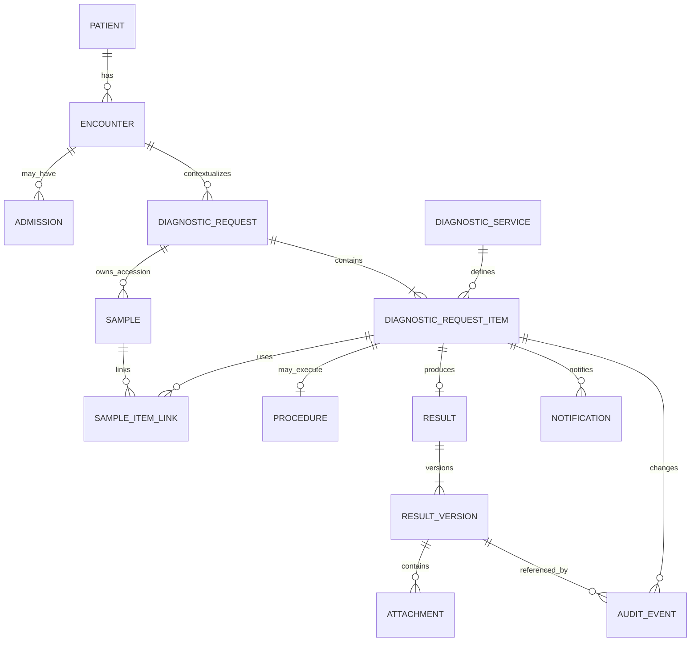

# Domain Model

**Knowledge status:** `DECISION` proposta para BUILD, baseada em `ASSUMPTIONS` do Discovery; accession, ownership clínico e integrações continuam `OPEN QUESTION` onde indicado.

## 1. Bounded contexts internos

| Context | Responsabilidade | Não deve possuir |
| --- | --- | --- |
| Identity | users, roles, sessions, scopes | regras clínicas |
| Registry | patient, owner, encounter, admission, external refs | resultado/estado de diagnóstico |
| Catalog | diagnostic services, workflow capabilities, SLA policies, reasons | execução concreta |
| Diagnostics | requests, items, aggregate status, commands de ciclo | conteúdo de resultado |
| Laboratory | sample/accession, receipt, recollection | autorização global |
| Imaging | procedure, schedule, performance, report workflow | paciente duplicado |
| Results | result, result versions, components, attachments, release/review | agenda clínica |
| Notifications | inbox, deliveries, acknowledgements, escalation | decisão clínica de crítico |
| Audit | immutable audit events e timeline projection | alterações de negócio sem command |
| Operations | queues, SLA projections, metrics | fonte paralela de status |
| Administration | config autorizada | apagar história clínica |

`DECISION`: módulos são limites de código dentro de um deploy, não microserviços. Cada módulo publica ports/commands/events; acesso direto a tabela de outro contexto requer interface documentada.

## 2. Entities and value objects

### Patient / Owner / Encounter / Admission

- `Patient`: `id`, display name, species, breed/sex quando permitido, birth/date approximation, status e external refs.
- `Owner`: pessoa/tutor mínima; dados pessoais sujeitos à política de privacidade.
- `Encounter`: `id`, patient, type, status, opened/closed timestamps, source system.
- `Admission`: período e localização (department/ward/bed) associados a encounter; transferências são eventos.
- `ExternalReference`: `source_system`, `external_id`, `entity_type`, unique por source/entity.

Ciclo de vida do `Encounter` (D9, D-036): nasce `OPEN` no cadastro do paciente ou em `POST /patients/{id}/encounters` e passa a `CLOSED` em `POST /encounters/{id}/close` (ou na alta aprovada da internação). Um paciente tem no máximo um atendimento `OPEN`; abrir outro exige encerrar o atual (`409 ENCOUNTER_ALREADY_OPEN`). Encerrar dá alta à internação aberta do atendimento, mas **não cancela exames**: os itens pendentes continuam com quem solicitou e o encerramento audita quantos eram (`pendingItems`). Solicitar exame em atendimento `CLOSED` é recusado (`409 ENCOUNTER_CLOSED`).

Invariant: request não cruza patient; encounter deve pertencer ao patient; external reference não é confiada como identidade única sem source.

### DiagnosticService and policies

`DiagnosticService` é catálogo configurável: `code`, `name`, `category`, `department`, `workflow_type`, `active`, `requires_sample`, `requires_schedule`, `allows_attachment`, `allows_structured_result`, `instructions`. `SlaPolicy` e `CriticalResultPolicy` são versionadas/configuráveis e referenciadas por item/resultado.

### DiagnosticRequest

Agrega contexto e itens:

- `id` técnico UUIDv7;
- `request_code` humano único;
- `patient_id`, `encounter_id`, optional `admission_id`/location snapshot;
- `requester_id`, `requesting_department_id`;
- `priority` (`ROUTINE`, `URGENT`, `EMERGENCY`);
- `aggregate_status` derivado;
- `created_at`, `updated_at`, `version`.

O request é agrupamento, não o resultado clínico. Cancelamento do request é uma command sobre itens elegíveis.

### DiagnosticRequestItem

Representa um serviço solicitado:

- request/service/department references;
- workflow type snapshot e policy IDs/version;
- item priority (default da request, override autorizado);
- lifecycle state;
- `requested_at`, `received_at`, `started_at`, `performed_at`, `resulted_at`, `released_at`, `reviewed_at`, `completed_at` quando semanticamente aplicáveis;
- `due_at`, `sla_started_at`, `sla_policy_version`, `overdue_at`;
- `version`, `cancellation_reason`, `rejection_reason`.

Não preencher timestamps só para “ter todos”: cada campo representa evento operacional real.

### Sample

Sample/accession pode atender múltiplos itens. Campos: `id`, `request_id`, `accession_code`, `sample_type`, `collected_at/by`, `received_at/by`, `status`, `replaces_sample_id`, rejection reason, version. Recoleta preserva a amostra histórica como `REPLACED` e cria um novo sample; `sample_item_link` registra item, status derivado, adequacy e timestamps. Na seam relacional transitória, a projeção também carrega a membership declarada para verificar que nenhum item esperado ficou sem vínculo ou recebeu vínculo extra.

**Accession gerado pelo sistema (D8, D-034).** Na criação da solicitação, cada item cujo serviço exige amostra recebe um `Sample` em `EXPECTED` com `accession_code` gerado no formato `<PREFIXO><AAMMDD>-<NNNN><C>`: `PREFIXO` de 1 a 4 caracteres `[A-Z0-9]` (`ACCESSION_PREFIX`, padrão `A`), `AAMMDD` o dia do calendário do hospital no momento da geração (`APP_TIMEZONE`, padrão America/Sao_Paulo: uma etiqueta impressa às 22h leva a data daquele dia), `NNNN` a sequência do dia (0001, 0002… pelo maior valor já existente + 1, seguro porque as transações são serializadas) e `C` o dígito verificador Mod-10 (Luhn) sobre os dez dígitos de data e sequência. Itens cujo serviço tem o mesmo `sample_type` no catálogo dividem o mesmo tubo (um `Sample` com vários `itemIds`); sem tipo no catálogo, cada item tem a sua amostra, com `sample_type` "A definir" até o recebimento. O `currentSampleId` do item aponta para a amostra desde a criação, e a recoleta também recebe um código gerado, não mais um provisório. Solicitações anteriores à D-034 continuam sem amostra até o recebimento, quando o código é digitado ou gerado.

### Procedure and schedule

Para workflows de imagem: `Procedure` referencia item e workflow-specific metadata; `ProcedureSchedule` preserva cada reserva/reagendamento com start/end, resource, status, reason, actor e `version` otimista. Não é uma agenda clínica geral.

### Result / ResultVersion / Report

`Result` é o agregado lógico por item. `ResultVersion` é snapshot imutável com sequence, content JSON validado, narrative/conclusion, author, release metadata, amendment reason, current/superseded/voided status, `needs_re_review` e `needs_replacement`. `Report` é um tipo de conteúdo narrativo de resultado, não uma cópia paralela. `ResultComponent` é opcional para painéis/analitos sem transformar cada componente em item operacional.

Invariant: depois de release, conteúdo não é editado in-place; amendment cria nova version. Review aponta para uma versão específica.

### Attachment

Attachment pertence à `ResultVersion`, não ao paciente solto. Guarda storage key, safe display name, original name redigido quando necessário, MIME detectado, size, checksum, scan status, uploader e created_at. Acesso passa por autorização do resultado atual/versão.

### Notification / Acknowledgement

Notification é uma intenção/registro para recipient, category, priority, entity deep link, delivery state e dedupe key. `Acknowledgement` registra actor/time/version e é distinto de view/review.

### AuditEvent

Immutable envelope: actor, action, entity_type/id, previous_state, new_state, correlation_id, timestamp server-side, metadata allowlisted, policy/version. Não guardar payload clínico completo sem necessidade.

## 3. Aggregate rules

1. Commands mutam apenas aggregate owner via application port.
2. Cross-context effects usam domain event/outbox, não update direto da tabela alheia.
3. Request/item ownership é estável; resultado não muda de item.
4. Versionamento otimista em aggregates mutáveis.
5. Terminal item não aceita novo trabalho normal.
6. Recollection cria nova sample; não transforma rejection em received retroativamente.
7. Current result version é única por logical result.

## 4. Relationships

## 5. Missing facts carried forward

OQ-005 (policy de crítico), OQ-008 (sample/accession), OQ-009 (agenda), OQ-011 (sistema mestre), OQ-015 (correção) e OQ-016 (result schema) precisam ser resolvidas antes de ativar variantes específicas em produção.

## Hospital planner — setores e acesso (HPL, 11/10/2026)

`DECISION` de implementação, BLD-HPL-011–013: `Department` possui `id`, `code` estável e único, `name`, `type` (`CLINICAL`, `DIAGNOSTIC`, `ADMINISTRATIVE`, `SUPPORT`), `responsibleUserId` opcional, `memberUserIds`, `active`, `version`, `createdAt` e `updatedAt`. Criar, editar, reativar, inativar e gerir membros são comandos auditados. Nenhum comando remove o objeto ou muda seu código. Setor inativo conserva referências e operações clínicas em andamento; novos vínculos, usuários e serviços exigem setor ativo. Associar membro ou responsável não concede paciente, serviço ou comando. Responsável deve ser usuário ativo do setor, integrante da equipe; mudanças de identidade/lotações reconciliam esse vínculo.

Os códigos existentes são materializados na migração 019 a partir das referências reais; não se cria responsável fictício. Bootstrap cria o setor administrativo informado, e não um catálogo clínico inventado. Novos setores são lidos do cadastro persistente. Não há lista fixa de setores para cadastro/navegação.

`DECISION`, BLD-HPL-008: o GET de resultado sem seletor conserva a regra clínica corrente. `versionId` permite abrir explicitamente apenas uma versão `RELEASED`, `SUPERSEDED` ou `VOIDED` do mesmo resultado, com escopo atual e permissões de leitura e histórico. Essa representação é somente leitura, identifica a invalidação e não gera `ResultViewed`, revisão ou confirmação crítica. Rascunhos não integram esse histórico. O template corrente não é evidência da definição histórica; BLD-HPL-021 conserva a definição utilizada.

`DECISION`, BLD-HPL-009: executor utiliza exclusivamente `serviceCodes` materializados. `serviceAccessPolicy` distingue `NONE`, `SELECTED`, `ALL_CURRENT`, e `includeFuture`. Futuro só acompanha `ALL_CURRENT` com escolha explícita. Legado sem campo preserva lista, sem autorizar novos serviços. Catálogo vazio não equivale a acesso global.

`DECISION`, BLD-HPL-021: cada revisão observada de serviço conserva uma `ExamDefinitionVersion` imutável: identidade do serviço, `serviceVersion`, estado `DRAFT`, `ACTIVE` ou `RETIRED`, definição completa, template/analitos/faixas configurados e autoria/data do registro. Registrar a definição anterior pela primeira vez ao editar o catálogo é uma observação atual, não prova de sua data de publicação histórica. Novos pedidos capturam `ExamDefinitionSnapshot` com proveniência `REQUEST_CAPTURE`, data e contexto do paciente; novos comandos de pedidos legados podem capturar a definição efetivamente usada com `COMMAND_CAPTURE_LEGACY_REQUEST`, sem afirmar que ela era a definição originalmente solicitada. A versão do resultado conserva essa captura e as faixas efetivamente aplicadas ao seu conteúdo. Nenhuma migração preenche versões clínicas antigas com o catálogo atual. Consulta histórica sem captura válida informa `UNKNOWN_LEGACY` e conserva o conteúdo registrado. Edição/importação posterior não reinterpreta resultado nem pedido existente; autorização continua usando o escopo corrente.

## Extensão HPL: administração de acesso

`AccessGroup` limita capacidades dentro de um perfil clínico/técnico; não redefine o perfil nem qualquer escopo. A inativação do grupo retira todas as capacidades dele, preservando conta, vínculo e histórico. Reativar recupera apenas a interseção com o perfil; novos vínculos e contas não entram em grupos base inativos. Alterar somente descrição não revoga sessões porque não muda a decisão efetiva.

Concessões individuais de paciente são explícitas para os perfis que usam `patientIds`. O cadastro de paciente mantém o vínculo assistencial já previsto para seu criador; outras equipes e responsáveis exigem concessão própria. Retirada é válida na próxima operação e na revalidação do realtime. Nenhuma regra de grupo elimina CSRF, sessão ativa, reautenticação de risco, autoria de rascunho, versões concorrentes ou a máquina de estados clínica.

### Aprovação clínica da referência laboratorial (BLD-HPL-021)

A preparação técnica produz um rascunho e não homologa faixas. A publicação exige comando clínico explícito, permissão efetiva `exam_definition.approve`, serviço e setor ativos, referência da política, população atendida e confirmação. A autoria e a data de aprovação são gravadas pelo servidor a partir do ator e do relógio atuais; metadados de aprovação enviados no rascunho são rejeitados. `VETERINARIAN` aprova o catálogo clínico visível sem restringir a sua lotação solicitante; `MANAGER` continua limitado aos setores delegados e `SUPERADMIN` atua globalmente. Aprovar catálogo não concede acesso a pacientes nem permissão de executar exames.

Na liberação laboratorial em produção, o painel congelado precisa ter aprovação, faixas numéricas homologadas e população compatível com espécie, sexo e idade conhecidos no contexto congelado. A ausência de contexto exigido pela política bloqueia a liberação. Dados demonstrativos podem permanecer explicitamente não interpretados; nenhuma faixa é inferida e a aprovação registrada não substitui o aceite clínico institucional exigido pelo gate de produção.

### Catálogo de capacidades hospitalares (BLD-HPL-020)

`HospitalService` define capacidades de cuidado (`CARE`), procedimento (`PROCEDURE`) e operação (`OPERATIONAL`). Cada definição pertence a um setor cadastrado e possui equipe descritiva e recursos aplicáveis. O serviço não é uma atividade executada nem concede permissão clínica aos membros de sua equipe. As definições diagnósticas continuam exclusivamente em `DiagnosticService` e aparecem no catálogo hospitalar por projeção, sem cópia persistente.

Códigos são únicos entre os dois catálogos. Criação, alteração do setor e reativação exigem setor ativo; novos vínculos de equipe exigem usuários ativos pertencentes ao setor. Recursos precisam existir no inventário institucional e estar ativos; até o cadastro de recursos estar disponível somente a lista vazia é aceita. A captura para uma nova atividade exige serviço/setor ativos e congela nome, revisão, setor, equipe e recursos realmente utilizados. Uma desativação ou mudança posterior não reescreve atividades existentes; a autorização da atividade continua atual e independente desta captura.

A importação de serviços gerais é atômica, permite prévia sem escrita, exige revisão esperada para alterações e aplica as mesmas permissões/referências do cadastro individual. Não importa nem substitui definições diagnósticas por esta autoridade.

### Planejamento diagnóstico (BLD-HPL-024)

Diagnóstico conserva sua FSM e laudo. O responsável por execução, diferente do autor da solicitação/rascunho, é escolhido entre profissionais ativos elegíveis. Executor assume a si; gestão reatribui dentro da delegação. Atribuição não concede paciente. Planejamento registra intervalo UTC e não cria reserva. Reclassificação tem unidade item e motivo obrigatório: mantém slaStartedAt e usa horas da definição congelada; no legado só usa catálogo quando a revisão coincide com slaPolicyVersion. Política histórica indisponível recusa a mudança. dueAt não reinicia desde agora; criticidade e etapas clínicas permanecem independentes.

### Visões salvas do planner (BLD-HPL-026)

`SavedPlannerView` conserva filtros e apresentação, com proprietário autenticado e compartilhamento opcional por setor. Compartilhar essa configuração não compartilha pacientes, tarefas ou capacidades; a consulta seguinte aplica os grants e o escopo atuais. Apenas o proprietário altera ou desativa a visão. Publicar/editar uma configuração compartilhada exige permissão de compartilhamento e setor ativo autorizado; retirar seu compartilhamento continua disponível ao proprietário com permissão de alteração.

Nome ativo é único por proprietário. Layout, colunas, agrupamento e ordenação vêm de uma lista de opções admitidas; período é UTC e exige início anterior ou igual ao fim. Referências de setor, tipo e responsável precisam existir no contexto permitido. O filtro de plano passa a exigir um plano real e autorizado quando a autoridade de planos for entregue; antes disso é recusado. Nenhum filtro persistido substitui autorização.

## Autoridade de atividades gerais e intake (BLD-HPL-023–028)

HospitalTask representa uma rotina operacional ou assistencial; DiagnosticRequest/DiagnosticItem continuam as autoridades de exames. Rotina pode existir sem paciente. Vínculo assistencial informa paciente e atendimento juntos, corretamente relacionados, com paciente ativo e atendimento aberto na criação. Serviço hospitalar opcional é congelado por versão; um serviço diagnóstico não pode ser usado para fabricar uma tarefa substituta de exame.

Tipos de tarefa configuram códigos/nomes de estados em quatro fases próprias: PENDING, IN_PROGRESS, COMPLETED e CANCELLED. Cada tarefa captura o tipo e seus estados. START passa de PENDING a IN_PROGRESS; COMPLETE passa de IN_PROGRESS a COMPLETED; CANCEL exige motivo em tarefa ainda aberta. Ator e horários reais são gerados pelo servidor. Campos de fase/estado/executor real não são editáveis por PATCH genérico. Revisar ou inativar um tipo afeta novas tarefas, preservando snapshots e comandos das existentes.

Autor, responsável, equipe executora e participantes são distintos. Datas planejadas validam início/fim e não representam reserva nem SLA diagnóstico. Reclassificar a prioridade da tarefa exige motivo e registra valor anterior/novo, sem mudar FSM clínica, criticidade de resultado ou reiniciar datas. Alterar contexto só é permitido em PENDING, com autorização antiga/nova, todos os membros elegíveis no destino e ausência de vínculos ativos de composição/dependência; a autoria e os grants permanecem.

Hierarquia e dependências compartilham a validação de ciclos. Bloqueio pendente afeta somente START ou COMPLETE indicado no vínculo; concluir pai não conclui filhos. Dependência diagnóstica conserva o ID real do item e só se satisfaz com seu estado COMPLETED; cancelar/rejeitar exame não equivale a conclusão. Reordenação é versionada e auditada.

HospitalIntake registra origem, recebedor, decisão, avaliador e destino. RECEIVED/DEFERRED admitem nova triagem; ACCEPTED/REJECTED/DUPLICATE são terminais. Adiar/rejeitar/marcar duplicidade exigem motivo. Aceite manual cria ou vincula uma tarefa uma única vez na mesma transação. Aceite de origem DIAGNOSTIC_REQUEST apenas vincula a solicitação original autorizada, sem substituir execução, ocultar pedido ativo ou aplicar cancelamento/rejeição clínicos. Encaminhamento exige autorização dos setores e do contexto envolvidos. Versão e idempotência protegem decisões concorrentes.

Motivos predefinidos exigem política institucional explicitamente configurada e vigente. Snapshot `reasonPolicy` conserva código, texto, versão e referência/data de aprovação; alterar configuração não reinterpreta decisão histórica. Sem aprovação configurada, permanece o motivo manual. Um padrão explícito pode preencher a confirmação de rejeição, preservando revisão humana.

## Recursos, ocupação e execução hospitalar (BLD-HPL-032–036)

HospitalResource cadastra profissional, sala, equipamento ou leito por ID estável. Código, tipo e vínculo do profissional não são reinterpretados por edição. Recursos pertencem a setor real; profissional exige colaborador ativo da equipe. A disponibilidade horária usa janelas UTC explícitas, exibidas no fuso institucional; ausência de calendário significa disponibilidade desconhecida. Leitos usam disponibilidade operacional, compatibilidade de espécies configurada e ocupação derivada de Admission, sem calendário horário ou ocupação paralela.

A coleção schedules permanece a única autoridade de reservas. Cada linha nova vincula exatamente um Procedure ou HospitalTask e congela as identidades/revisões dos recursos usados. Exames e tarefas disputam todos os IDs na mesma transação, em intervalos [início,fim). Remarcação preserva a reserva anterior cancelada. Reservar não executa tarefa ou exame e não muda dueAt/SLA. Procedimentos vinculados iniciam somente com reserva vigente, recursos/profissional elegíveis e instante dentro da janela; atraso exige remarcação explícita antes de iniciar. Uma execução em andamento que ultrapasse o fim planejado continua ocupando o recurso no momento presente até sua conclusão real. Textos legados permanecem identificados como não vinculados, sem aproximação por nome.

Novas reservas e internações em produção exigem inventário real e IDs explícitos. Em demonstração/transição, texto legado só permanece disponível enquanto não houver inventário pertinente ativo no setor. Com leitos cadastrados e Admission vigente sem bedResourceId, o setor não admite nova ocupação antes de reconciliação explícita auditada. BED_CHANGE do próprio Admission legado pode vincular um ID real sob a política D-01; o sistema não infere localização nem comprova ocupação física. Censo indica UNRECONCILED e capacidade disponível desconhecida até a conciliação. Alta/consulta e pendências ativas continuam acessíveis conforme as permissões existentes.

O calendário distingue reserva, prazo diagnóstico e execução real. Capacidade nominal/reservada/disponível usa minutos de janelas explícitas para recursos horários e unidades de leito para o censo vigente; calendário ausente ou ocupação não conciliada retorna null em disponibilidade, sem estimativa inventada. Carga contém apenas trabalho autorizado. D7/D-032 continua contando horas corridas desde a solicitação; nenhum calendário pausa ou recalcula esse prazo.

A estimativa total de carga é conhecida somente quando todos os objetos abertos autorizados têm estimativa explícita em minutos. Atualmente HospitalTask pode informar esse metadado; exame diagnóstico não possui estimativa equivalente. Conjunto vazio retorna zero e conjunto parcialmente conhecido retorna null. Indicadores separa carga atual de capacidade no período sob definição técnica HPL-CAPACITY-1; não mistura minutos e leitos nem infere utilização clínica.

Cuidados e procedimentos não diagnósticos exigem checklist com processo clínico aprovado, modalidade CARE/PROCEDURE, perfis elegíveis e referências de confirmação/sistema clínico fornecidas pelo responsável. A Task conserva esse snapshot; COMPLETE genérico não confirma processo clínico. care.execute exige grants atuais, atribuição, paciente/atendimento válidos, etapas obrigatórias e confirmação explícita. A evidência registra ator/horário do servidor e referência declarada pelo executor ao prontuário adotado; não representa entrega externa, prescrição, administração medicamentosa ou validação automática. Nenhuma modalidade do piloto é semeada como homologada; o aceite clínico institucional permanece obrigatório.

### Planos, turnos e rotinas hospitalares

O `HospitalPlan` organiza objetivo, período, etapas e referências às autoridades existentes (`HospitalTask` e `DiagnosticItem`). Repetir uma referência em etapas não duplica execução nem o denominador do progresso. A leitura retira referências inacessíveis e calcula etapas e totais apenas sobre atividades autorizadas. `BLOCKED` deriva da dependência vigente do comando da tarefa; uma dependência não autorizada continua bloqueando, sem expor título ou identificador. `pendingActivities` representa atividades não concluídas, incluindo cancelamentos que não cumprem o objetivo do plano. Encerrar ou arquivar um plano não altera tarefas, exames, laudos, prazos ou confirmações de crítico.

`HospitalShift` registra equipe e substituições no setor durante o intervalo absoluto `[startAt,endAt)`. Sobreposição de plantões para o mesmo profissional é rejeitada; intervalos adjacentes são válidos. A cobertura vigente revalida usuários, equipe e permissões atuais. O plantão não concede paciente nem substitui automaticamente `onCall`, cuja mudança exige corte operacional aprovado. Vincular ou transferir uma atividade entre turnos altera somente sua associação e versão, conservando o prazo e o estado da fonte. Arquivar um turno mantém pendências e escala histórica.

A passagem `HospitalHandoff` permanece `OFFERED` com o responsável anterior até o recebedor nominal aceitar. A oferta e o aceite exigem escopo e elegibilidade atuais para cada pendência, equipe do turno de destino e versões das autoridades originais. Uma pendência desatualizada aborta todo o aceite. Recusar não transfere nada. O aceite registra quem assumiu cada atividade sem conceder paciente, reiniciar FSM/SLA ou confirmar crítico. Links e contagens de auditoria são redigidos na resposta conforme o acesso atual; a trilha persistida permanece íntegra.

`HospitalChecklistTemplate` nasce `DRAFT`, exige aprovação clínica rastreável para novas ocorrências e pode ser retirado sem alterar a execução anterior. Editar um modelo aprovado volta sua definição atual para `DRAFT`; o snapshot já capturado continua imutável. Etapas registram executor, horário, evidência e versão; invalidar evidência exige motivo e preserva o registro original. Concluir uma tarefa de checklist exige suas etapas obrigatórias vigentes. Um processo clínico aprovado ainda exige `care.execute`, modalidade, papéis elegíveis e referência ao sistema de registro e à política de confirmação. O comando genérico de tarefa não conclui esse cuidado nem comprova administração de medicamento.

`HospitalRecurrence` usa intervalo em minutos sobre instantes absolutos e fim exclusivo. Cada ocorrência é identificada por `(recurrenceId,occurrenceAt)` na própria tarefa. Criar a tarefa e avançar o cursor ocorrem na mesma transação; recuperação após indisponibilidade é limitada por lote e não duplica a ocorrência. Modelo sem aprovação, autor inativo ou concessão retirada bloqueiam a geração sem avançar o cursor. A reexecução preserva tarefas e evidências anteriores e informa pendências ainda não geradas. Não há aprovação ou execução clínica produzida pelo job.
### Documentos operacionais e edição concorrente — BLD-HPL-039/048

A biblioteca operacional possui identidade, setor e responsável próprios. Um documento mantém revisões numeradas, uma revisão publicada vigente e, no máximo, um rascunho. Conteúdo estruturado de uma revisão `APPROVED` ou `RETIRED` é imutável: editar conteúdo aprovado requer novo `DRAFT`. Publicar uma nova revisão retira a anterior da vigência e preserva seu conteúdo, autoria e aprovação. Retirar ou arquivar não apaga histórico nem altera a revisão já capturada em tarefa ou plano. Duplicar cria outra identidade e registra a origem.

Aprovação exige comando explícito, confirmação, referência institucional e versões esperadas do documento e do rascunho. O servidor registra autor e instante atuais; `hospital_document.approve` é efetiva somente para `VETERINARIAN`, `MANAGER` e `SUPERADMIN` no setor autorizado. `ADMIN` prepara rascunhos e metadados, mas não homologa conteúdo clínico. Essa declaração no programa não substitui a homologação institucional do gate de produção.

Vincular documentos exige acesso atual à tarefa/plano, seu comando de alteração, `hospital_document.view` e compatibilidade de setor. A captura inclui conteúdo e identidade exatos da revisão aprovada vigente; não muda permissões do alvo. Consultas posteriores revalidam acesso ao documento antes de emitir a captura. A revisão capturada permanece histórica mesmo depois de retirada, sem reinterpretar conteúdo a partir da biblioteca atual.

Edição simultânea usa concorrência otimista: cada alteração informa versões esperadas, identifica o editor e gera auditoria. Um conflito retorna `409` e exige recarregar e conciliar; nenhuma alteração sobrescreve silenciosamente outro editor. Eventos de atualização contêm metadados para recarga autorizada, sem conteúdo do documento. Bloqueio e arquivo impedem edição e novas capturas conforme seus comandos, sem apagar consultas históricas. O conteúdo rico aceita apenas blocos e marcas definidos no contrato; não aceita HTML, scripts ou links com credenciais.
### Contrato externo operacional e assistência opcional — BLD-HPL-042/050

`CVG_OPERATIONAL_V1` é um contrato do Hub, não uma alegação de compatibilidade homologada com fornecedor HIS/LIS/PACS. A instalação representa uma instituição. Sistemas e jornadas adotados precisam de sandbox, validação do contrato e aceite externo; sem configuração aprovada, a capacidade fica indisponível. O adaptador aceita exclusivamente endpoint HTTPS, hosts e IPs explicitamente configurados pelo operador, conexão com DNS fixado no IP aprovado, credenciais em arquivos privados, HMAC, limites de resposta e confirmação por recibo remoto real.

O hospital informou `cvg-his-v4` como HIS adotado. O perfil separado `HIS_V4` segue sua descoberta `X-API-Key` e webhook real v2 (`timestamp.body`, validade de 300 segundos), sem inventar sequência CVG. Somente `encounter.created` de atendimento aberto pode originar demanda `RECEIVED`, após mapa explícito paciente/atendimento HIS para IDs Hub existentes, ação/setor/tipo/prioridade aprovados e autorização nativa atual. Não adota outros eventos, não infere vínculos e não executa nem aceita a demanda automaticamente. Reentrega, inclusive com novo delivery ID/webhook recriado, preserva uma única demanda por identidade do payload; colisão ou novo evento para o mesmo atendimento exige conciliação. Descoberta/anúncio técnico não substitui homologação real; o bloqueio de destinos privados existente no HIS permanece intacto.

Credenciais de serviço têm ator, sistema, finalidade, validade, restrições de setor/paciente, rotação e revogação. O token aleatório é devolvido uma vez, nunca persistido como texto; o banco guarda somente seu hash. Ele só autentica o ingresso dedicado de integração, não a API comum de sessões. O ator e as permissões atuais continuam obrigatórios: a credencial reduz acesso e não concede grants. HIS cria uma demanda manual sujeita à triagem vigente. LIS/PACS criam somente rascunho do item executado pelo ator, com versão, autoria, definição congelada e validações atuais; não liberam laudo, executam diagnóstico, confirmam crítico ou revisam resultado.

Mensagem externa possui identidade, finalidade, entidade externa, sequência e hash. Duplicidade com conteúdo distinto, finalidade divergente ou sequência fora de ordem é rejeitada. Ingresso, comando original e recibo pertencem à mesma transação. O envio externo usa referência à autoridade original e versão esperada, revalida acesso antes de transmitir, envia chave de idempotência e exige recibo válido para afirmar aceite. Timeout é resultado incerto e pode ser repetido explicitamente usando a mesma identidade; nenhuma falha é rotulada como entregue. Rastreamento mantém hashes, IDs e códigos, sem payload clínico em auditoria ou logs.

Assistência de texto é opcional e desligada por padrão. `CVG_DOCUMENT_ASSISTANCE_V1` exige fornecedor, finalidade `OPERATIONAL_DOCUMENT_TEXT`, modelo, referência de decisão institucional e configuração de conexão aprovados antes de transmitir conteúdo. Solicitação exige confirmação específica e versão atual do rascunho. Resposta recebe estado `PENDING_REVIEW`; aplicar exige revisão humana, motivo e versões ainda atuais, alterando somente o rascunho. Sugestão nunca publica documento, libera resultado, prescreve, confirma crítico ou executa comando clínico. Configuração e testes sintéticos não substituem avaliação de dados, utilidade e homologação do fornecedor.

### Colaboração, conveniência privada e rascunhos — BLD-HPL-037/038/044/045/046/049

Comentários de tarefa preservam autoria e revisões anteriores. Somente o autor edita; remover comentário alheio exige moderação e motivo. A remoção entrega um marcador sem conteúdo nem revisões, preservando o registro interno. Cada menção exige pessoa ativa com acesso atual à tarefa e à conversa; não cria concessões. Depois de existir conversa ou upload, o contexto de paciente/atendimento da tarefa não pode ser transferido para outro paciente.

Anexos de tarefa têm autoridade própria, sem fabricar versão de laudo. Sessões privadas exigem identidade do remetente, tamanho, SHA-256, tipo permitido, prazo e versão da tarefa. Envio possui lease exclusivo; armazenamento e varredura precedem nova validação de sessão, concessões, contexto e lease. Somente arquivo CLEAN e FINALIZED pode ser baixado, com autorização e integridade revalidadas após aguardar os bytes. Falhas liberam a tentativa abandonada; quarentena não é anexada nem baixada.

O inbox de trabalho guarda referências opacas, não nomes de pacientes nem conteúdo de comentários. A leitura resolve o alvo e seu acesso vigente antes de lista, contagem ou marcação. Marcar lido/não lido, arquivar e reagir são conveniências: não confirmam resultado crítico, aceitam passagem nem executam atividade. Preferências de conveniência não mudam as notificações clínicas obrigatórias. Avisos de prazo revalidam destinatários e avançam por lotes, sem duplicar a mesma identidade de origem por usuário.

Favoritos, agrupamento de favoritos, recentes, seguir e notas pessoais pertencem ao usuário. Cada leitura ou replay revalida o recurso de origem; alvo revogado ou arquivado não reaparece por preferência. Notas pessoais não compõem prontuário, eventos SSE ou auditoria textual. Seguir não concede acesso.

Rascunho de tarefa é privado ao autor e à gestão com escopo vigente, fica fora das listas/buscas ativas por padrão e não é execução. Publicação revalida contexto e captura definições/modelos/documentos vigentes, preservando identidade e autoria; descarte registra encerramento do rascunho, sem inventar cancelamento ou tempo clínico. Conteúdo rico usa blocos estruturados validados, sem HTML executável. Labels, estimativa em minutos e links HTTPS são metadados; estimativa não substitui duração real. Reações pertencem à identidade autenticada e podem ser retiradas.

Arquivo de tarefa conserva identidade, execução e histórico. Exige estado terminal, escopo atual, gestão ou equipe responsável e ausência de subtarefa ativa. Restaurar não reinicia execução. Lotes são limitados a 50 identidades distintas e retornam sucesso/falha por item: um erro não é rotulado como sucesso total. A chave do lote vincula o conteúdo antes da primeira mutação; comandos individuais têm identidade derivada para recuperação e replay seguro.
